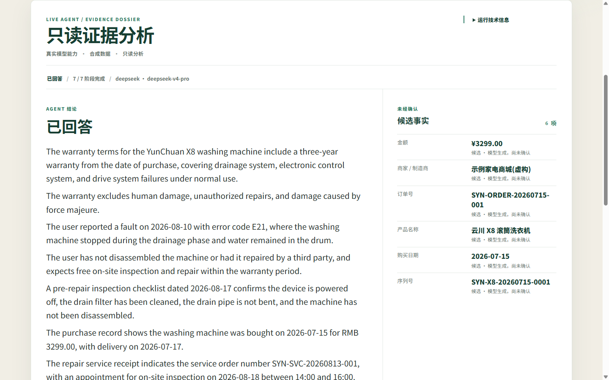

# LifeCase

LifeCase 是一个本地优先、证据链驱动的个人事务工作台。它以 Case 为核心，把用户主动导入的票据、邮件、文本型 PDF 等材料整理成可追溯事实，并帮助处理保修、退款、报销和订阅取消等事务。

数据默认保存在本机。LifeCase 不会自动发送邮件、提交网页表单、付款、签署文件或删除原始材料。



## 主要功能

- 本地 FastAPI、React/Vite 工作台和 SQLite 持久化；
- TXT、EML 和文本型 PDF 材料导入、稳定分段与 Case-scoped 全文检索；
- Claim 来源引用、人工确认、纠正历史和矛盾标记；
- 保修、退款、报销和订阅取消四类案件模板；
- 可复核的证据分析、候选事实、引用和版本历史；
- Deadline、Action、Approval、ICS 和 Case 时间线；
- 可独立校验的 Evidence Pack，以及本地 Backup/Restore；
- 桌面与移动视口共用的响应式界面。

## 从源码运行

要求：Windows PowerShell、Python 3.12～3.14、[uv](https://docs.astral.sh/uv/)、Node.js 20.19+、npm，以及锁定依赖所需的本机包缓存。

```powershell
powershell -NoProfile -ExecutionPolicy Bypass -File scripts\lifecase.ps1 setup -DataRoot "$env:LOCALAPPDATA\LifeCase"
```

入口会恢复锁定依赖、构建 Web、初始化明确的数据目录，并启动单一 loopback API/Web 服务。缺少缓存时会失败关闭，不会静默联网补齐。可使用同一脚本的 `start`、`status`、`stop`、`upgrade` 和 `uninstall` 命令管理应用。

停止服务：

```powershell
powershell -NoProfile -ExecutionPolicy Bypass -File scripts\lifecase.ps1 stop -DataRoot "$env:LOCALAPPDATA\LifeCase"
```

## Windows 安装包

仓库包含自包含应用和当前用户安装器的构建脚本。安装器无需管理员权限，可创建桌面与开始菜单快捷方式，并在卸载时默认保留用户数据。构建和验收方式见 [Windows Installer](docs/WINDOWS_INSTALLER.md)。

公开仓库不直接提交 EXE、数据库或运行数据。二进制发布物应通过 GitHub Release 分发，并同时提供 SHA-256 校验文件。

## AI 与安全边界

LifeCase 的分析能力以证据和人工复核为中心，不是可自由行动的通用聊天机器人。

- 模型 Provider 默认关闭，不会自动发现或调用凭据；
- 分析限定在当前 Case，必须明确预览并确认；
- 分析只读，不提供外部工具，也不会代表用户执行操作；
- API Key 仅可保存到当前 Windows 用户的 Credential Manager，不写入 SQLite、浏览器存储或仓库；
- 导入内容、模型响应和外部数据均按不可信输入处理；
- 示例、截图和固定评估仅使用合成或不可逆脱敏数据。

详细说明见 [Security and Privacy](docs/SECURITY_AND_PRIVACY.md)。

## 项目结构

```text
apps/
  api/                    FastAPI、领域服务、SQLite、检索与测试
  web/                    React 工作台及 feature-owned UI
packages/
  case-templates/         版本化案件模板
  contracts/              跨边界 JSON Schema
fixtures/
  synthetic-cases/        产品回归使用的合成材料
docs/                     架构、安全和安装说明
scripts/                  PowerShell 运行与验证入口
```

## 验证

```powershell
uv sync --frozen
npm ci
.\scripts\verify.ps1
```

API 文档默认位于 `http://127.0.0.1:8000/docs`。

## 当前限制

- 仅提供响应式 Web 界面和 Windows 本机打包路径，没有原生桌面 UI、移动 App、托管服务或自动更新；
- 本地构建的安装器默认未签名；
- OCR、通用聊天、SSE 和外部连接器未包含在当前版本中；
- 解析进程有硬超时，但尚未提供操作系统级 CPU、内存和网络沙箱；
- 当前代码不代表企业生产部署认证或真实个人数据的长期持续使用验证。

## 文档

- [Architecture](docs/ARCHITECTURE.md)
- [Security and Privacy](docs/SECURITY_AND_PRIVACY.md)
- [Windows Installer](docs/WINDOWS_INSTALLER.md)
- [Contributing](CONTRIBUTING.md)
- [Security Policy](SECURITY.md)

## 许可证

当前仓库尚未授予开源许可证。未经版权所有者明确许可，不得复制、分发或再许可本项目代码。
