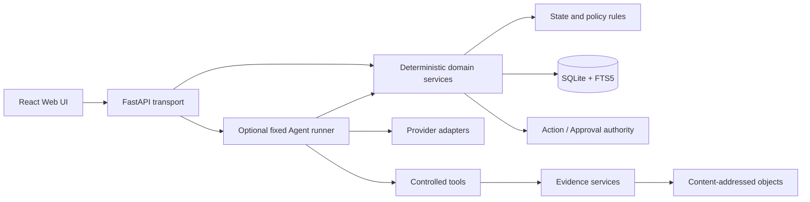

# Architecture

For current scope and module ownership see [STATUS](STATUS.md) and [PROJECT_MAP](PROJECT_MAP.md). Milestone IDs below explain historical additions, not incomplete work or authorization gates. Current product work follows one warranty transaction through evidence, current facts, question analysis, reviewed Action, human outcome and explicit Case resolution. Web is the primary surface; public hosting, multi-user operation and external execution are not implemented by that direction.

## Current composition

| User result | Owner and boundary |
|---|---|
| Import and manually retry failed extraction | Source authority and existing extraction service; retry preserves the original Source |
| Review/correct facts and update the preparation sheet | Claim commands and current-facts projection; saved intent has its own version; copy/TXT re-read authority |
| Ask a Case question and reanalyze changed evidence | Live q1 Run, immutable question/basis binding, one `validate` stage; answers do not confirm facts |
| Review and explicitly save a repair draft | `AnalysisActionDraftService` delegates to existing Action authority; no extra model call or automatic approval |
| Record progress/result and complete an Action | Append-only human observations, then a separate versioned completion command with checked evidence |
| Decide whether the Case is resolved and revisit it | Independent Case transition; workbench retains ended Cases; Action history and Timeline are read projections |

The default question path is not the earlier extraction workflow. `portfolio-live-q1-` uses `validate`; `portfolio-live-v2-` keeps `extract -> validate`; older Live IDs, explicit Fake Demo and historical evaluators retain the seven-stage contract. The API supplies `stage_order`. No historical Run is rewritten or silently moved to a different order.

## Context

LifeCase is a local application with a browser interface. A Python process binds to loopback, owns domain rules and storage, and serves a typed API. The Web client renders cases and approvals but does not become the source of truth.



## Runtime components

### Local API

- binds to `127.0.0.1` by default;
- exposes `/api/v1` and generated OpenAPI;
- owns request validation and error translation;
- exposes persisted Run progress through explicit requests; no SSE or background autonomous worker is present.

Development keeps Uvicorn and the Vite development server separate. M7-03 adds a distinct daily-use topology: `scripts/lifecase.ps1` restores locked repository dependencies from local caches only, builds the Web client, validates an owned data root, and starts one detached Python/Uvicorn process that serves `/api/v1/*` and `apps/web/dist` from one loopback origin. The Windows EXE packages that same topology: `LifeCase.exe` embeds the API, built Web and reviewed templates; `LifeCaseSetup.exe` only owns per-user program files, shortcuts and uninstall registration. Mutable authority remains in the separate marked data root. Missing package caches fail closed rather than accessing a registry. Application model configuration remains disabled by default. P1-01 adds Case-scoped Agent Demo routes, but they compose StageRunner only after explicit `LIFECASE_PORTFOLIO_AGENT_DEMO` opt-in and only with server-owned Fake Provider scripts. P1-02 adds an independent Ollama factory/adapter that constructs no client or call until explicitly selected and invoked; no existing HTTP/Web route invokes it. Startup performs no model generation or SSE streaming. With explicit saved settings, P1-11 may restore a Windows credential and construct the fixed configured process client; synthetic validation must disable that restoration before application construction.

The read-only `GET /api/v1/system/ai-capabilities` projection reports the allowlisted cloud Provider boundaries and evaluation-only Ollama plus server-owned runtime status. It exposes no credential or client object and authorizes no run. Its current consumer is the separate global AI settings drawer; the older Agent-area P1-10 catalog placement was superseded.

P1-11 adds a separate local configuration plane: `GET/PUT/DELETE /api/v1/system/ai-settings` and a global React drawer. One allowlisted Provider and fixed model may be saved; the API Key is written as one Generic Credential in the current Windows user's Credential Manager and reconstructed into a process client on startup. Non-Windows or explicit test configurations report persistence unavailable. Keys never enter the application database, object data, browser storage, response models, access logs or repository files.

P1-12 keeps that plane closed while allowing two DeepSeek models. Migration 16 permits multiple `agent_run` rows per Case, but ordinary StageRunner callers remain single-run by default. Only Live Agent opts into history and the bounded same-Case retrieval fallback, requires a terminal latest Run plus fresh consent, and exposes the newest Run with compact preserved summaries. P1-01 Fake composition remains unchanged. Goal tokenization is shared; only Live Agent enables the closed warranty-alias fallback. Actual model identity continues to come from persisted stage metadata, never from a later global setting.

### Domain services

Domain services are plain Python and do not depend on FastAPI. They own state transitions, Claim rules, evidence requirements, deadlines, action dependencies, and close conditions.

### Case lifecycle

`CaseStatus`, `CaseTransitionCommand`, and immutable Case/transition results form the M2-01 aggregate boundary. `CaseService.transition_case()` is the only lifecycle write path. It obtains a SQLite immediate write transaction, reloads authoritative state, compares `expected_version`, checks the explicit state edge, updates Case status/version/timestamps conditionally, appends one history row, and commits. Domain and API callers cannot bypass the same guard table.

Resolved and abandoned Cases record their first closure time. They can only be archived, which preserves that time; archived Cases cannot transition. History reads are ordered by committed version. Action completion does not resolve a Case. The user separately supplies the Case transition, actor/reason and expected Case version; Web re-reads Case authority and preserves unsaved edits on conflict or an uncertain read. Persistence semantics and actual process-restart acceptance are distinct; see current evidence in [STATUS](STATUS.md).

### Claim provenance

`ClaimValue`, typed Claim states, source references, and explicit create/attach/confirm/correct/reject commands form the M2-02 boundary. `ClaimService` is the only Claim write path. Each write obtains an immediate transaction, reloads the authoritative Claim version, validates the operation, appends an immutable event, recalculates same-Case/same-field active-candidate contradictions, and commits all effects together.

ClaimSource stores identifiers, authoritative segment hash, excerpt offsets, and excerpt hash rather than copied text. Both writes and reads join through Source and SourceSegment, enforce equal Case ownership, and recompute segment/excerpt hashes. Evidence confirmation requires a current supporting citation; an explicit user confirmation creates a separate value/version-bound confirmation record. Corrections retain prior/new canonical values, actor, reason, and UTC time. M2-02 performs no retrieval, context construction, model call, or template evaluation.

### Built-in Case template engine

M2-03 separates the business Case type from the workflow-template identity. The closed reviewed registry contains `warranty -> warranty_claim@1`, `return_refund -> return_refund_claim@1`, `reimbursement -> expense_reimbursement@1`, and `subscription_cancellation -> subscription_cancellation_claim@1`. Both `template_id` and `template_version` are persisted and revalidated on Case reads; an unknown or mismatched binding fails closed. The legacy create-request field named `template_id` continues to accept the business Case-type selector for compatibility, but it is not the persisted template identity.

Each of the four built-in YAML resources is selected by registry code, packaged with the API wheel, and parsed into frozen typed values. The parser accepts no path or URL input and rejects unknown or duplicate keys, explicit tags, aliases/anchors, wrong types, empty or duplicate identifiers, and bounded-size/depth violations. Template evaluation reuses the authoritative M2-02 Claim reader, including canonical value-hash validation. Only non-contradictory `confirmed` or `corrected` Claims satisfy a field; confidence is never truth authority. Named conditional inputs are finite set membership, and close-condition evaluation is pure: it cannot call or bypass the M2-01 state machine.

`GET /api/v1/templates` is a thin read-only catalog over that closed registry. The React intake surface must explicitly submit one catalog `case_type`; it displays the persisted template identity after refresh but cannot load YAML, define requirements, or infer Case type. M7-01 adds no template editor, dynamic plugin path, migration, or per-type service fork.

### Stage runner

One pure-Python `StageRunner` runs over the provider protocol. The current Web question path uses only `validate`; the S1 compatible path uses `extract -> validate`. The original M3-02 order (`extract`, `normalize`, `link_claims`, `classify_case`, `check_gaps`, `propose_actions`, `validate`) remains for old Runs, the explicit Fake Demo and historical evaluation paths. Every definition freezes stage/input/output/checkpoint versions, strict output envelope, timeout, stop conditions, and one repair ceiling. Only the specialized validate definitions may use the local, read-only Evidence Context search.

The persisted `portfolio-live-v2-` Run ID marker selects the two-stage order; unmarked legacy IDs keep their original order and contracts. The two-stage validate input is `validate.rag.input.v2` with one prior `extract` checkpoint reference; legacy `validate.rag.input.v1` still requires six. Output/checkpoint versions and authority checks are unchanged. This is a bounded compatibility distinction, without a new table, migration, dependency or generic workflow/version framework. S1 removes five placeholder calls from new production execution; it does not manufacture replacement checkpoints or change deterministic template, Claim, preparation-sheet or approval services.

Question Runs use `portfolio-live-q1-<uuid>` and `validate.question.v1`, with no extraction checkpoint. Migration 18 adds canonical input-binding JSON/hash to the existing Run: original question, separate retrieval expression, current-fact values/versions/confirmation/source references and bounded material metadata. It does not change Case goal or encode the question in the ID. `question_context.py` recomputes the authority basis before execution and projects `current`, `changed` or `unavailable` for history. Commands bind the displayed `expected_run_id`; restart/recovery cannot replace its question. RAG checks current-fact references separately from original quotations and rejects old quotations used to override a corrected value. Reanalysis creates a fresh Run and preserves old results.

### Case workbench projection

M4-01 adds a read-only `CaseService.list_workbench_cases()` projection and a thin `GET /api/v1/cases` route. One stable SQLite read transaction combines authoritative Case state, the production M2-03 gap evaluator, and the latest timestamp from Case, Source import, extraction, Claim, or Agent run. Today contains all non-terminal Case states; resolved, abandoned, and archived Cases remain in the full list. Ordering is Today first, priority descending, activity time descending, then Case ID ascending.

The projection creates no table and mutates no domain or index state. M5-02 composes an authoritative bounded `next_action` summary from committed Actions; `deadline_risk` remains `not_calculated` rather than inferred. M5-01 adds a separate validated Deadline panel but does not change the summary risk field because no risk policy exists. The React workbench renders loading, empty, offline, safe server-failure, and populated states.

### Evidence review projection

M4-02 adds a read-only `EvidenceReviewService.list_case_review()` projection and thin `GET /api/v1/cases/{case_id}/evidence-review` route. One stable SQLite read transaction loads the exact built-in Case template, active same-Case candidate/inferred Claims, same-field confirmed/corrected values, and formal ClaimSource records. Every citation is freshly rejoined in SQL to authoritative same-Case Source/SourceSegment rows and checked for sequence, page, text hash, quote bounds, and quote hash. Any invalid persisted citation fails the complete projection closed.

Review ordering is deterministic: reviewed template field order before lexicographic extension fields; contradictory values first within a field; inferred before candidate; then creation time and Claim ID. The first item is the next uncertain field. The projection creates no table and performs no write. Confirm, correct, and reject actions call the existing M2-02 Claim endpoints and service invariants, including optimistic versioning, evidence/user basis, immutable history, contradiction recalculation, and atomic rollback.

The React evidence surface compares authoritative Segment text and highlighted quote, candidate value, and every settled same-field value. It requires explicit actor and reason inputs and provides Alt-key review shortcuts. It renders source-free candidates as explicit-user-confirmation decisions rather than manufacturing evidence or actor identity. M4-03 timeline/recovery and M5 deadlines/actions remain separate boundaries.

The deterministic manual-intake command is a narrow companion to the review projection. React selects one template field, one same-Case Segment, exact quote bounds, a value, actor label, and reason. `ManualClaimService` reloads the bound reviewed template, rejects fields outside that template, reloads and hashes the authoritative Segment, validates the quote bounds, computes the quote hash server-side, and delegates the candidate plus supporting citation to `ClaimService`. Browser text, hashes, lifecycle state, and readiness are never authority. The Deadline, Action/Approval, and Case-transition controls likewise invoke existing domain commands; they do not reimplement their legal graphs.

### Current facts and warranty preparation

`claims/current_facts.py` provides a separate all-current-Claim read projection through `api/current_facts.py`. It reuses ClaimService and source validation in a read transaction, exposes recorded human/evidence confirmation, marks conflicts and unavailable evidence, and never writes state. Unlike `evidence-review`, settled facts remain visible after the active queue is empty.

`features/warrantyPreparation/` derives a Chinese sheet from that projection, current Case sources and explicitly entered intent. Only usable confirmed/corrected facts become positive statements. Copy and local TXT download share the fresh-authority check; failed reads block export, and changed inputs require rechecking the new preview. Missing-field links return to the matching existing intake/review control, including the warranty serial number. Source locations use Unicode code-point offsets, with browser hash/ownership validation and stale-request protection. Preview/copy/download does not update Actions, approvals, historical drafts, Evidence Packs or Runs.

The intent can be explicitly saved through `cases/preparation.py` and `api/warranty_preparation.py`. Migration 17 adds one Case-owned current-intent table with its own version and timestamp; it does not change Case lifecycle versions or fact history. The Web editor reads saved intent on entry, preserves local input on conflict/uncertain writes, and requires a fresh comparison before another save. Facts and citations remain fresh projections, not saved snapshots. Existing SQLite backups include the intent; no dependency, model, background job or generic draft framework is added.

### Timeline and recovery projection

M4-03 adds a read-only `TimelineService.list_case_timeline()` projection and thin `GET /api/v1/cases/{case_id}/timeline` route. One stable SQLite read transaction begins from the authoritative Case and admits existing Source/import, Source extraction, Artifact, Case transition, Claim event, Agent-run, and Agent-stage rows only. It never creates a second event store or migration.

Immutable Case and Claim histories must have contiguous versions and end at the current authoritative status/value. Source extraction counts must equal retained Segment authority. Artifact Source/Agent parents, Agent stage parents, Case IDs, hashes, checkpoint hashes, enums, versions, and timezone-bearing timestamps are revalidated. Any incomplete, cross-Case, stale, or corrupt association fails the complete read closed.

Events sort oldest first by UTC time, closed kind rank, then authority ID. Mutable extraction and Agent rows appear honestly as their latest persisted status snapshot, not fabricated intermediate history. M5 adds committed Deadline, Action, and Approval events; approval availability is explicit and communication availability is an Action draft projection, not an external-send history. The React event spine restores from the Case ID in the URL after refresh and re-reads SQLite after API restart; browser state is never Timeline authority.

Migration 19 adds append-only `action_progress` observations. Timeline projects their committed actor/reason, kind and recorded Action version separately from `action_completed` and the Case's `resolved` transition. A result note is neither completion evidence nor proof that the Case is solved. Ended Actions retain read-only observations and completion-evidence references; reading a historical result does not restore its old approval as current authorization.

### Deadline engine

M5-01 adds one Case-scoped `DeadlineService` as the only Deadline write path. Frozen models keep `explicit`, `calculated`, and `suggested` kinds structurally distinct from the `proposed`, `confirmed`, `passed`, `completed`, and `dismissed` lifecycle. A date is either a canonical UTC instant or a calendar-only local date; both retain an explicit validated IANA timezone and visible date kind. A timezone-naive instant is never interpreted through the host timezone. Local wall-time conversion explicitly rejects daylight-saving gaps and requires a fold choice for overlaps.

An explicit Deadline derives its exact date only from one current, non-contradictory, `confirmed` or `corrected` Claim in the same Case. The binding stores Claim ID, version, value SHA-256, and date kind, and reads rejoin the current Claim before returning the Deadline. A calculated Deadline uses the closed `calendar_days_after_basis@1` rule, canonical bounded parameters, and authoritative basis Claims. The calculation depends only on basis values, rule identity/parameters, and timezone; audit timestamps are not calculation inputs. A suggested Deadline has no Claim or rule basis and is labeled as a personal preference rather than an obligation.

Creation commits the Deadline, ordered basis rows, and a created event inside one immediate transaction. Status commands use optimistic versions, increment exactly once, append one immutable event carrying the definition hash, and roll back atomically. Reads recompute Claim authority, calculated output, rule-parameter and definition hashes, and contiguous history. Thin HTTP handlers translate typed failures only. The responsive Web surface re-reads committed SQLite authority and keeps `deadline_risk=not_calculated` until a separately reviewed risk policy exists.

Timeline integration occurs after Deadline history exists. The stable Case-scoped Timeline transaction calls the Deadline service's transaction-aware read boundary and projects only committed Deadline events; browser draft state is never an event source. M5-01 creates no Action, Approval, communication, ICS, calendar, email, connector, or external execution path.

### Action planner and approval boundary

M5-02 adds an independent `ActionService`; FastAPI and React cannot compute readiness, blockers, graph order, risk, or completion eligibility. Its closed registry defines `collect_evidence`, `prepare_communication`, `follow_up`, and `record_outcome`. A Case-scoped Action stores canonical payload authority, optimistic version, immutable events, ordered same-Case dependencies, explicit Claim requirements, an optional Deadline ID/version/definition-hash binding, and completion-evidence references. Reads use one stable transaction to rejoin every Claim, Deadline, dependency, Source, and Artifact. Missing, contradictory, cross-Case, cyclic, or history-incomplete authority fails the whole projection closed. An expected dependency version that becomes stale after a legitimate upstream transition remains visible only on its already-blocked Action; execution stays forbidden until an explicit service revalidation refreshes the binding and immutable history.

M5-02 statuses are `proposed`, `blocked`, `ready`, `running`, `done`, `failed`, and `cancelled`; M5-03 also admits `approved`. The service derives a canonical blocker snapshot and stable topological order. The original `prepare_communication` form projects explicitly bound confirmed/corrected Claims. The question-linked form additionally retains the user-reviewed draft text and exact analysis Run/basis/answer hashes in the existing versioned payload. Neither form has a send/submit executor. Action risk is the reviewed A/B/C/D capability class and does not populate the separate `deadline_risk`, which remains `not_calculated`.

M5-03 adds a separate `ApprovalService` and only then admits an Action's `approved` status. Approval requests bind the exact Action version, payload SHA-256, canonical visible summary SHA-256, local actor label, and immutable decision history. Action revision, revalidation, or cancellation and Approval invalidation share one transaction. Risk A may enter local running without Approval; Risk B requires its configured local authorization; Risk C may record approval but remains non-executable; Risk D is rejected. The actor label is audit metadata, not authentication.

`AnalysisActionDraftService` accepts only the current completed, answered q1 Run in the same warranty Case. Preview/save revalidate question basis and citations; save additionally compares Run version, basis/answer hashes and any saved Action version. It uses the existing Action create/revise transaction, preserving actor/reason, bound fact requirements and approval invalidation. The preview is deterministic and does not request another model response. Changed/unavailable basis or failed reads block use of an old draft while Web retains the user's edit.

`ActionProgressService` reads and appends human `progress`/`result` entries against the exact Case, Action version and last-progress ID. Append does not advance Action version/status, confirm facts or approve work. Starting, completing and cancelling remain separate domain commands; completion revalidates Source/Artifact evidence. A changed-basis Action can guide the user to reanalyze and explicitly save a new Action, then independently decide whether to cancel the old one. No approval or cancellation is inherited automatically.

Web `SavedActionCopy` re-reads the exact Action and current basis before copying saved text. `SavedActionAnalysis` re-reads its binding and selects that original Run from same-Case history, even when a newer Run exists; unavailable history never falls back to another answer. Action list groups current work, changed-basis decisions and ended records without changing stored status or suppressing unknown-basis warnings.

ICS export remains a pure Case-scoped read and HTTP response, not a table, Artifact, connector, or system-calendar write. It accepts only a confirmed Deadline after full basis/rule/history validation. UID derives from stable Deadline authority, DTSTAMP from committed authority time, UTC instants emit UTC `DTSTART`, and local dates emit `VALUE=DATE` while retaining their IANA timezone in LifeCase metadata. The export intentionally contains bounded ASCII authority metadata only; canonical ordering, 75-octet folding, CRLF, and a bounded safe filename make identical committed input byte-identical.

### Evidence Pack authority and publication

M6-01 adds `EvidencePackService` under `evidence/pack` as the only Case-pack assembly path. It holds one `BEGIN IMMEDIATE` SQLite snapshot while revalidating the Case, Sources, Segments, Claims, Deadlines, Actions, Approvals, Artifacts, and Timeline through their service boundaries. The deterministic ZIP uses fixed member paths, order, timestamps, permissions, and stored compression. `original/`, `derived/`, `generated/`, and `confirmed/` preserve the product's authority layers; `manifest.json` declares format/member metadata and `checksums.sha256` covers every member except itself.

The service writes a same-volume temporary archive, independently verifies portable paths, membership, sizes, and every SHA-256, then publishes by no-overwrite hard link and commits one existing `artifact.type=pack` row in the same transaction. Failure rolls back metadata and removes an unreferenced publication. Identical authority produces identical bytes and reuses the existing Artifact. Prior `pack`, `manifest`, and `backup` artifacts are excluded from embedded artifacts and Timeline events, preventing recursive growth. Downloads always revalidate the retained file and archive; FastAPI and React do not assemble or trust packs. M6-01 adds no backup/restore, external service, model, connector, email, or browser submission path.

### Backup and restore authority

M6-02 is separate from Evidence Pack. `BackupService` first asks SQLite's online backup API for a committed database snapshot, then reads object references from that snapshot rather than the live connection. Source and Artifact references are reconciled against the complete data root: missing, extra, cross-root, symbolic-link, size, or hash drift fails closed. The portable stored ZIP contains `database/lifecase.sqlite3`, `data/<authority-relative-path>`, a canonical versioned manifest, and complete SHA-256 membership. Active WAL/SHM files, upload staging, local absolute paths, credentials, and unreferenced files are never members.

Restore has two commands. Validate extracts only into isolated recovery staging, checks archive/path/size/hash policy, SQLite integrity and foreign keys, the exact supported migration prefix, and database-to-object references, then retains a content-hash ticket. Apply always repeats validation, constructs a new sibling staging runtime, runs the existing migration runner and domain read services, checkpoints SQLite, and atomically renames staging to a previously nonexistent target below the configured recovery root. The active runtime is never switched, overwritten, merged, deleted, or repaired in place. Application startup inspects migrations without mutating the database; an existing database is backed up and verified only when migrations are pending, and migration cannot begin if backup fails.

### Offline thirty-case evaluation

M7-02 adds a repository-local `lifecase.evaluation` boundary rather than an HTTP or business-persistence path. It reads only the fixed `m7-v1` synthetic corpus, validates exact portable membership and versioned schemas, and scores independently stored expected labels against recorded synthetic observations. It never writes expected JSON into Case, Claim, Deadline, Action, Agent, or export authority.

The evaluator recomputes input and quote SHA-256 values, enforces Case-scoped identifiers, validates IANA timezone/date-kind and deterministic Deadline rule shape, applies the documented critical-field normalization, and checks the six-part Action rubric plus risk/approval safety. Canonical JSON and Markdown omit clocks, locale-dependent values, source bodies, and machine paths. The report separately counts reviewed product templates and evaluation-only records: subscription cancellation is reviewed and Web-selectable, while travel/logistics remains outside the product registry. Recorded outputs prove the scoring/provenance contract only, not live-model semantic quality.

One durable `agent_run` belongs to exactly one Case and aggregates the pipeline budget. Each `agent_stage_run` belongs to the same `(run_id, case_id)` through a composite foreign key. Before each provider call, `BEGIN IMMEDIATE` verifies optimistic versions, fixed stage order, exact input-scope hash, and both budget levels, then records the call and reserves input/output tokens plus CNY minor cost. Provider work occurs outside the transaction. A successful result is reduced to a bounded canonical checkpoint only after exact-envelope validation. Stage prompts, complete material bodies, raw provider output/SDK objects and credentials are not persisted. q1 separately retains the explicit bounded question/fact/source binding described above; that binding is not a transcript or a second fact authority.

Schema failure permits at most one repair and accounts both calls. Missing provider cost charges the explicit reservation; currency mismatch or usage above reservation fails closed. Cancellation, timeout, provider failure, exhausted budget, and a second schema failure stop at `cancelled` or `needs_review` without modifying Case, Claim, Source, FTS, template, or Evidence Context authority. A process interruption leaves a visible reservation; explicit recovery conservatively charges it, clears the reservation, and records `agent_interrupted`. Successful checkpoint, cancellation/failure accounting, and recovery are each atomic and use optimistic durable versions.

The original P1-01 composition uses `PortfolioAgentDemoService` with a scope-keyed Fake script. Live also reuses this service with a separately composed provider and the Run-specific registry; the historical filename is not a pure-Demo boundary. Agent HTTP commands cannot submit provider output/checkpoints, choose arbitrary tools or invoke domain approval/external effects. Manual Claim/Action/Approval UI commands remain separate. No background worker, SSE or general chat loop exists.

### Evidence-backed extraction

M3-03 defines a separate `extract.warranty.v1` schema for merchant/manufacturer, product, purchase date, order number, amount, and the template's warranty identifier field `serial_number`. The request contains only explicitly supplied, typed Evidence Context segments. The checkpoint must dispose each field exactly once as `extracted`, `inferred`, or `unknown`; direct and inferred values require bounded source references, while unknown values create no Claim.

`WarrantyExtractionCheckpointHandler` validates the checkpoint before M3-02's single repair decision and rechecks authoritative Source/SourceSegment state inside finalization. It maps direct `extracted` facts to `candidate + created_by=agent`, inferred facts to `inferred + created_by=agent`, and never creates `confirmed` state or user authority. A transaction-aware ClaimService batch entry point keeps Claim, ClaimSource, immutable Claim history, contradiction flags, Agent usage, and checkpoint atomic. Run-scoped Claim projection uses the immutable created event's actor Run ID, so a reanalysis never presents prior-version candidate facts as current. M3-03 adds no HTTP/UI, retrieval tool, question answering, or RAG path; those remain M3-04.

M3-04 adds `evidence_context.search.v1` as a risk-A, local, read-only tool over the unchanged M2-04 service. A validate-stage request permits exactly one call, has a 1-5000 ms SQLite deadline, retains the existing Case-scoped SQL and authority checks, and caps retrieval at 10 hits, adjacent expansion at two Segments per direction, and Context text at 32,000 UTF-8 bytes so the complete ephemeral stage input remains under the 100,000-byte Agent boundary. Tool output is never an authority or durable business row.

`validate.rag.v1` accepts only `answered` statements with exact quote references or `unknown` with no statements and an explicit reason. The handler replays the bounded formal Context request and requires byte-for-byte projection/hash equality, then verifies Case/Source/Segment/sequence/page/text hash, quote offsets, and quote hash before repair and again inside checkpoint finalization. The durable checkpoint keeps bounded answer text, citation identities/hashes, and tool hash/count only; it does not persist Context bodies. Validate mutates no Case, Claim, Source, Segment, FTS, template, or tool state, and M3-04 adds no HTTP/UI or live-provider composition.

### Storage

SQLite stores structured state and rebuildable search projections. Every configured connection actively proves FTS5, the trigram tokenizer, MATCH, and BM25 support; startup fails with a typed configuration error if the required capability is absent. The object store keeps immutable source bytes and derived artifacts. Database rows reference content hashes; absolute machine-specific paths are not part of portable exports.

### Local retrieval

M1-05 retrieval is a plain Python service with no FastAPI, model-provider, or Agent dependency. It requires an explicit Case ID, executes MATCH and Case filtering in one SQL statement joined through authoritative Source and SourceSegment rows, orders by SQLite BM25 ascending, then by Source ID, sequence, and Segment ID for deterministic ties. Returned citations are immutable typed values backed by a fresh identifier/text-hash validation.

The FTS5 trigram table is a searchable copy only. It can be deleted and transactionally reconstructed from SourceSegment rows, while missing, stale, or inconsistent projection state fails closed. Evidence selection, overlap removal, adjacent expansion, and context budgeting remain owned by M2-04; exposing retrieval to an Agent remains owned by M3-04.

### Evidence Context

M2-04 composes the unchanged M1-05 `RetrievalService` into a pure Python, read-only domain service. Every request carries an explicit Case ID, retrieval query/limit, adjacent-before/after bounds, an explicit Source trust-label allowlist, and UTF-8 text-byte budgets. The builder starts one stable SQLite read transaction, distinguishes a missing Case from no matches, and obtains initial hits only through the production Case-scoped FTS service.

Initial matches remain separately ordered by their original BM25 rank. Policy-denied matches are omitted. For allowed matches, same-Source sequence ranges are clamped to authoritative bounds, overlapping or touching ranges are merged, and merged windows are ordered by their earliest match rank, then Source ID and sequence. One Segment appears at most once, while its ordered `match_ranks` retain every window that selected it.

Every initial and adjacent Segment is freshly joined through Source and SourceSegment with the Case predicate in SQL. The builder recomputes `text_sha256`, validates a zero-based continuous Source sequence, and fails closed on missing, stale, cross-Case, malformed, or changed authority. It loads only bounded matched windows rather than complete Source bodies.

Context budgeting counts exact UTF-8 bytes of Segment text. A complete Segment is admitted only when it fits both the per-item and total ceiling; otherwise it is omitted and the result is marked truncated. Text is never sliced, so citations and hashes cannot be separated from partial content. Evidence Context is an ephemeral typed result, not persistence or an answer. It exposes no HTTP/UI, model, Agent tool, or external side effect in M2-04.

### Model provider boundary

M3-01 introduces one async `ModelProvider.generate_structured()` protocol over frozen, versioned request, result, usage, call-metadata, and safe-error values. The request carries opaque request/scope identifiers, separate system and stage instructions, a JSON object payload, a strict JSON Schema, and a bounded output-token ceiling. It deliberately does not define an Agent stage schema or make model output authoritative.

Provider selection is explicit and defaults to `disabled`. `DisabledModelProvider` fails with a stable typed configuration error, while all deterministic Case, Claim, template, retrieval, and Evidence Context services remain usable. `FakeModelProvider` returns only an explicitly supplied synthetic script keyed by the request-scope SHA-256 and performs no discovery, credential read, or network access.

`OpenAIResponsesProvider` accepts a narrow async client injected by approved runtime composition. It maps the current Responses API shape with `store=false`, a developer instruction plus user JSON input, `text.format.type=json_schema`, `strict=true`, and `max_output_tokens`. It rejects non-completed responses, refusals, malformed output, abnormal usage, oversized content, timeouts, cancellation, network failures, rate limits, and remote errors through stable provider-neutral failures. SDK/HTTP response objects and remote error bodies stop inside the adapter.

P1-05A/P1-05B add a server-owned `ProviderRegistry` and immutable capability contract rather than a generic OpenAI-compatible URL. A profile carries provider identity, fixed endpoint preset, allowed/selected model, strict structured-output mode, usage/cost metadata availability, storage control, disabled stream/tools, process-injected credential source, timeout and byte ceilings. OpenAI resolves to the official Responses endpoint. Groq resolves only to its official Chat Completions endpoint and `openai/gpt-oss-20b`; Mistral resolves only to `https://api.mistral.ai/v1/chat/completions` and non-moving `mistral-small-2603`. Arbitrary host/model configuration is rejected.

`GroqChatProvider` maps three fixed system/developer/user messages, strict `json_schema`, bounded `max_completion_tokens`, `stream=false`, `tool_choice=none`, disabled citations and omitted reasoning into the same `StructuredGenerationResult`. The Chat API does not support a `store` request parameter, so the profile requires an explicit server assertion that Groq organization ZDR is enabled; otherwise composition fails before a call. Usage is required, cost metadata is unavailable and the existing pre-call CNY reservation remains authoritative. Migration 12 only admits `groq` as safe durable stage metadata.

`MistralChatProvider` combines the system and stage instruction into one fixed system message, sends the canonical stage input as one user message, and uses strict `json_schema`, bounded `max_tokens`, temperature 0, `stream=false`, `tool_choice=none`, and no tools or unsupported `store` parameter. The Registry requires an explicit server assertion that Mistral organization ZDR is enabled; otherwise composition fails before a call. Required `prompt_tokens`/`completion_tokens`/`total_tokens` map to the same provider-neutral usage, while cost remains unavailable. Migration 13 only admits `mistral` as safe durable stage metadata.

P1-11 adds `GeminiGenerateProvider` for fixed `gemini-2.5-flash` on the official `generateContent` endpoint and `AnthropicMessagesProvider` for fixed `claude-sonnet-4-5-20250929` on `/v1/messages`. Both request structured JSON, disable streaming/tools by omission, map usage into the provider-neutral result and remain subject to local Schema/business validation. Standard-library HTTPS clients fix every host and header contract; the settings API cannot accept a base URL. Migration 15 admits `gemini` and `anthropic` as durable stage identities.

P1-05D fixes the official DeepSeek Chat endpoint and JSON Object contract. P1-12 extends its closed model allowlist from only `deepseek-v4-flash` to `deepseek-v4-flash|deepseek-v4-pro`, with model-specific nominal prices and response-identity validation. Requests remain non-thinking, non-streaming and tool-free; local Schema/business validators and one repair remain authoritative. `/live-agent` composition still requires an injected process-local client and explicit data-use confirmation, and the default remains disabled.

P1-06 adds no Provider or product route. A Windows composition shell checks/builds the existing Web bundle, while `lifecase.deepseek_live` validates a dedicated marked runtime and free loopback port before reading the key through a hidden terminal prompt. The credential exists only in the injected client in that one process. A separate loopback CLI creates two fixed synthetic Cases through existing HTTP contracts and emits only URLs plus bounded result metrics. Reset is allowed only for an exact absolute directory carrying the P1-06 marker and never for a drive/home root or active listener.

P1-02 adds `OllamaChatProvider` as a separate provider identity. Its standard-library client has no configurable host: it can POST only to `http://127.0.0.1:11434/api/chat`. Every request is non-streaming, fixes `think=false` and temperature 0, uses the stage output-token ceiling as `num_predict`, and passes the exact output JSON Schema in `format`. The adapter rejects incomplete, non-object, malformed, abnormal-usage, oversized, timeout, cancellation, loopback-network, rate-limit, and remote responses through the same provider-neutral failures. It records no credential or monetary cost and exposes no raw response, thinking trace, prompt, or private error body. Migration 11 admits `ollama` as durable provider metadata without changing checkpoint or business authority.

Normal provider logs contain only provider, validated model ID, request-scope hash, latency, token usage, optional cost values, and stable error information. Prompt/evidence text, output JSON, credentials, local paths, SQL, and remote private errors are excluded. M3-01 itself added no persistence; M3-02 consumes this boundary through durable metadata/accounting and validated checkpoint state. P1-02 changes only provider identity/adaptation and that metadata CHECK; it adds no HTTP/UI composition, Claim authority, retrieval behavior, or external effect.

P1-03 added a provider-injection seam to `PortfolioAgentDemoService` and a standalone `lifecase.evaluation.ollama_agent` command. The P1-01 route/UI keeps its server-owned Fake Provider; Live Agent separately injects its configured adapter. The evaluator creates fresh temporary synthetic warranty Cases, injects the existing fixed-loopback Ollama adapter, exercises the unchanged seven-stage runner/extraction/RAG/Claim authority, reopens SQLite to compare the safe recovered projection, then deletes the temporary root. It emits aggregate status, safe failure codes, call/token counts, citation and Claim metrics, and bounded timings only; it emits no source body, identifier, database/object path, checkpoint, raw response, or detailed log.

The P1-03 compatibility observer is outside the authoritative runner. It compares only a provider-neutral candidate with that call's exact requested JSON Schema and reduces mismatches to a closed content-free category set. P1-05C adds a second, extraction-specific diagnostic over the canonical business parser: a code may contain only the fixed reviewed warranty field name (or `checkpoint`) and one closed failure class such as `origin_contract`, `source_ref_authority`, or `quote_authority`. It emits no JSON path, candidate value, identifier, hash, evidence body, checkpoint, or validator/remote detail. The canonical StageRunner still performs the decisive Schema and business-authority validation with the same one-repair ceiling. If no candidate returns before timeout, the observer records no category or business code; it does not infer a cause from timeout metadata.

Before extraction finalization, `StageCheckpointHandler.normalize()` supplies one deterministic authority boundary shared by the evaluator and durable runner. Exact citations that already match the current Segment remain unchanged. Model-proposed quote offsets and quote hashes are treated as untrusted derived metadata: when source, Segment, and complete Segment hash exactly match current same-Case authority but the quote metadata does not, the handler replaces only that metadata with a full-Segment citation. A wrong source, Segment, or Segment hash still fails closed and can use only the existing single repair. Only the normalized canonical checkpoint can reach persistence; the raw candidate and Evidence Context body are never retained.

P1-04/P1-05 add a separate product composition above the unchanged Provider and StageRunner boundaries. P1-11 lets `AiSettingsManager` construct one fixed client from the OS credential and provide an effective immutable configuration through request dependencies. `LiveAgentService` still reports disabled/unavailable/ready and delegates profile validation/composition to `ProviderRegistry`; no route can select an arbitrary host or bypass the existing Case preview/consent boundary. The optional `deepseek_live.py` launcher remains a separate short-lived demo path.

For the compatible two-stage path, preview loads extraction's bounded first 32 warranty Segments plus the validate RAG Context. For the current question path it previews the independent question, current facts and bounded retrieved material. Both include configured Provider/model, the fixed whole-Case budget and read-only notice in authorization. The browser confirms the exact preview hash; q1 also submits the reviewed original question. q1 persists its authorization inside the input binding; two/seven-stage IDs retain their earlier scope convention. Changed evidence/model/budget cannot silently reuse consent. See [Agent design](AGENT_DESIGN.md) for the exact path distinctions.

Execution composes the fixed OpenAI, Groq, Mistral, DeepSeek, Gemini or Anthropic adapter and reuses the runner, one repair, validated checkpoints, budgets and recovery. Normal q1 analysis invokes the adapter once; the compatible S1 Run invokes it twice; repair and explicit retry are accounted separately. Eligible legacy Runs still execute their original seven-stage order. Only extraction writes candidate/inferred Claims; q1 analysis does not duplicate candidates or alter current facts. Only global settings accept the allowlisted Provider/fixed model/Key configuration. Account controls, billing, live model quality and real-personal-data suitability remain unverified unless separately tested.

`CaseAgentWorkspace` makes the Live question analysis primary and keeps the Fake Demo behind a secondary disclosure. `LiveAgentDossier` presents the bound question/basis, answered-or-unknown conclusion, citations/current facts and optional runtime metadata. API Run/history `stage_order` supplies one-, two- or legacy seven-stage progress without claiming removed capabilities. See the [question analysis record](evaluation/case-question-analysis-20260919.md) and [S1 record](evaluation/production-agent-simplification-20260918.md) for their separate acceptance boundaries.

### Web client

The client calls the local API through Vite proxy in development. `App.tsx` combines the existing intake, overview, review, analysis/actions and record surfaces; features own their transport and editor state. Same-Case response checks and navigation generations prevent old reads from replacing the selected Case. Unsaved editor retention is distinct from durable save. No browser state is fact, approval, Action or Timeline authority. Concurrent create/navigation remains a separately tracked investigation in [STATUS](STATUS.md), not an already verified guarantee.

## Dependency direction

```text
api -> domain services -> domain models
case service -> built-in template registry
agent -> domain services + tool protocols + provider protocols
tool implementations -> storage/security/provider adapters
storage -> domain models
web -> feature-owned transport types aligned with FastAPI OpenAPI
```

Forbidden directions:

- domain packages importing FastAPI;
- storage calling model providers;
- UI deciding domain state transitions;
- provider objects entering domain entities;
- imported content influencing system instructions or tool registration.

## Agent lifecycle and manual decisions

Persisted Run statuses are exactly `queued`, `running`, `checkpointed`, `needs_review`, `cancelled`, and `completed` (`agent/models.py`). A stage is `running`, `checkpointed`, `needs_review`, or `cancelled`. Failure/retryability is represented by safe error metadata and the existing recovery rules, not extra Run `failed` or `needs_approval` states. Successful final checkpoint completes the Run; eligible explicit retry/recovery must retain its input scope, reservation accounting and original stage order. Action approval is a separate domain state machine and does not add an Agent stage.

## Data flow for source import

1. UI receives an explicit user file selection and sends one multipart `file`; browser paths are never an API input.
2. API streams the UploadFile to a random, bounded staging file in a configured root outside the data root. The original display name is reduced to a safe basename.
3. Existing SourceImporter and object storage validate staging containment, size, regular-file status, and media-type policy.
4. Evidence service streams SHA-256, then copies into a secure temporary file in the final object's directory.
5. After byte count, source identity, and hash validation, a no-overwrite hard link atomically publishes the object.
6. Storage transaction creates Source and Artifact metadata; failed metadata removes only a newly published, unreferenced object.
7. Extraction loads the Source row, derives only its canonical object path, and validates containment, regular-file status, byte count, and SHA-256 before parsing.
8. A spawned child process validates and parses TXT, EML, or text PDF under a hard timeout; HTML, scripts, attachments, macros, and OCR are not executed.
9. The parent deterministically segments the returned text and revalidates object identity.
10. One explicit SQLite transaction deletes the prior Source FTS projection, replaces the complete SourceSegment batch, inserts the new projection, and records extraction status/version; any write failure restores both the prior authoritative batch and its prior index entries.
11. M1-05 retrieval reads Case-scoped segments through the rebuildable projection, then validates every hit against authoritative IDs, Case ownership, text, and text SHA-256. A later Agent receives only a separately validated, budgeted Evidence Context with provenance identifiers.

Each HTTP request owns one configured SQLite connection. FastAPI lifespan initializes directories and applies migrations before serving requests. The Web client stores only the Case ID in the URL fragment, then reloads Case and Source projections from the API after refresh.

## Local deployment

The repository supports two normal runtime modes and a separate historical demo launcher:

- development: API at `127.0.0.1:8000` and Vite at `127.0.0.1:5173`;
- daily-use: one Uvicorn process serves the API and built static assets at `127.0.0.1:<selected-port>`.
- DeepSeek synthetic demo: an explicit short-lived Uvicorn process serves the same built Web/API on loopback with one injected process-only client and a separate marker-bound data root.

No inbound LAN binding or public tunnel is supported by default.

The P1-06 demo path is `start -> hidden key -> health-ready browser -> seed -> explicit live authorization/execute -> safe aggregate`. Its historical acceptance used the same Case/Source APIs and then-seven-stage runtime for both Case variants; only their fixed server-side Case goal differed, producing one cited `answered` and one citation-free `unknown`. Compatible no-question Live calls now follow S1's two-stage order, while current Web questions use q1's single validate stage. Historical acceptance is not evidence of quality for either changed path. Deadline, Action, Approval and external-effect services are not called by the demo execution path.

The daily-use parent launcher holds an exclusive startup lock until readiness completes; the child separately creates token-bound runtime state. A server is reported running only after pending migrations, verified pre-migration Backup, SQLite/FTS capability, API health, capability response, and static index checks succeed. Startup failures request graceful shutdown, use a bounded hard-stop fallback, remove only same-PID owned control state, and retain data. Setup, upgrade, stop, and uninstall do not delete or move the selected runtime root.

Package completion, a short synthetic package acceptance, optional seven-day private dogfood, and the 27/30 product-processing gate are distinct evidence. The package cannot claim the latter three merely because startup succeeds; the Portfolio MVP explicitly records dogfood as `NOT_RUN`.

### Package source mapping

- FastAPI documents mounting a static application independently from API routes: <https://fastapi.tiangolo.com/tutorial/static-files/>. LifeCase mounts built assets last so `/api/v1/*` remains authoritative.
- Starlette documents `StaticFiles(directory=..., html=True, follow_symlink=False)` and startup directory validation: <https://www.starlette.io/staticfiles/>. LifeCase adds stricter index/assets/no-link preflight before process publication.
- Uvicorn documents explicit host/port, worker, and logging settings: <https://www.uvicorn.org/settings/>. LifeCase fixes host to `127.0.0.1`, one worker, and no access log; user input cannot enable LAN binding.

These sources define framework behavior only. LifeCase owns data-root containment, startup lock/state, migration/Backup ordering, typed errors, readiness probes, and cleanup tests.

## Failure model

- File import: same-directory temporary write plus atomic no-overwrite publish; partial files are cleaned safely.
- SQLite write: explicit transaction; busy timeout; foreign keys enabled.
- Extraction: safe typed errors, spawned parser process, hard timeout, stable reruns, and whole-batch rollback.
- Retrieval: typed capability/query/index failures; bounded FTS syntax and limits; no full-scan fallback; explicit transactional rebuild from authoritative segments.
- Evidence Context: typed request/configuration/integrity/persistence failures; stable read snapshot, SQL Case scope, authoritative hash/sequence validation, whole-Segment byte budgeting, and no answer generation.
- Model provider: disabled-by-default selection, pre-call size checks, one hard timeout, provider-neutral response validation, stable retryability classification, and safe metadata-only logs; no implicit retry or durable write.
- Case transition: typed invalid-edge/version failures; conditional optimistic update plus append-only history in one transaction; any write failure restores the prior Case and history.
- Claim provenance: typed invalid-operation/version/source failures; authoritative Case/Source/Segment revalidation; Claim, citation, event, confirmation, and contradiction changes roll back together.
- Agent stage: reserve call/token/CNY budget before the call; checkpoint only after exact schema and checkpoint validation; preserve every prior completed stage.
- Model timeout/cancellation/interruption: reconcile the reservation conservatively, retain prior checkpoints, and stop at typed `needs_review` or `cancelled` state.
- Export: build in a temporary directory, verify hashes, then publish the final archive.
- Migration: automatic backup, version row, single transaction when SQLite permits, otherwise documented forward repair.

## Evolution rules

- Introduce an abstraction only when a second real implementation or a security boundary requires it.
- Add Redis, Celery, Temporal, or a remote database only after measured single-process limits.
- Keep the existing Windows package as a delivery path; do not make another shell or a general workflow layer a prerequisite for Web product improvements.
- Add connector write access only through a new ADR and threat-model update.
