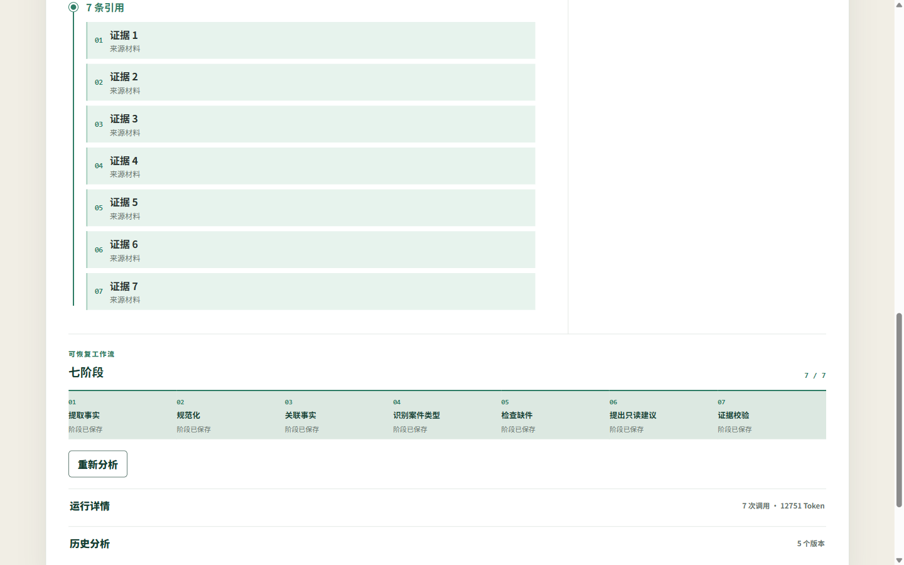
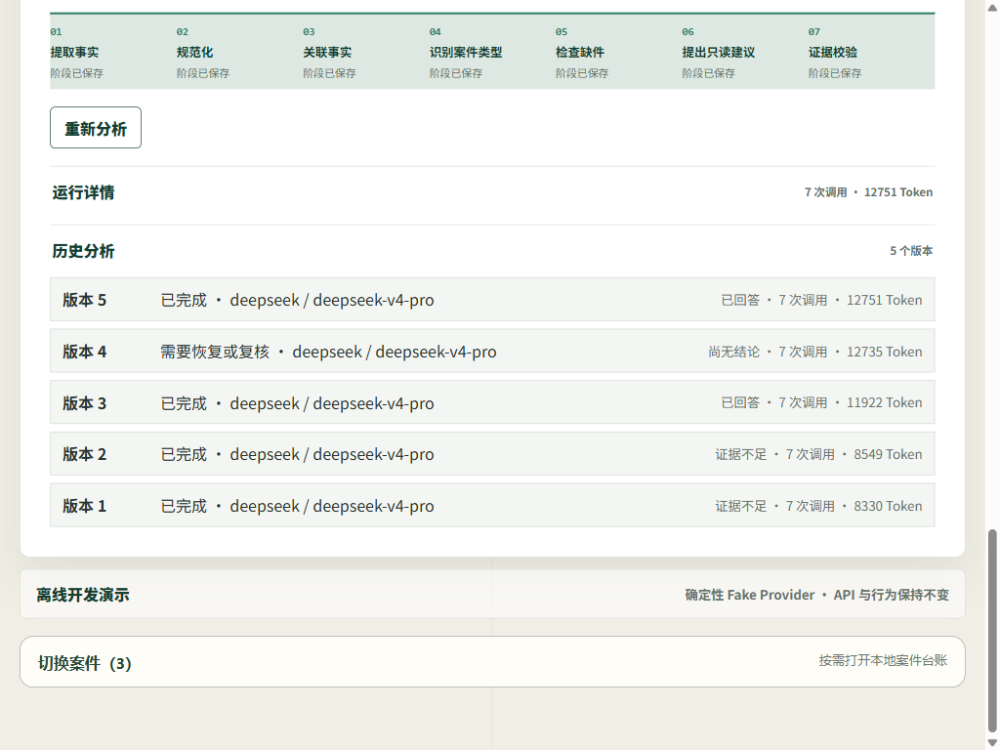
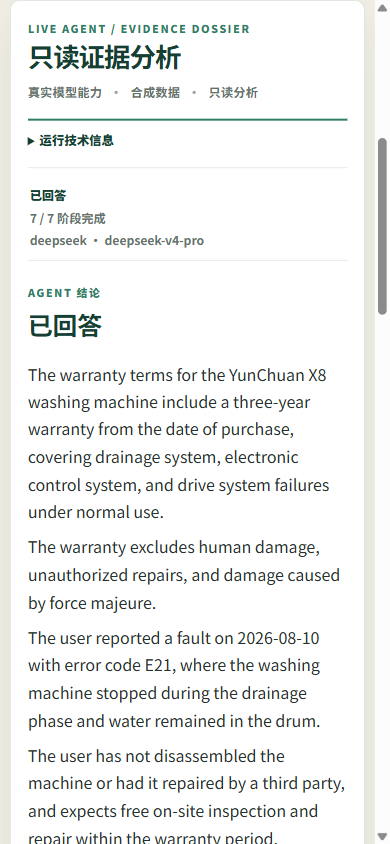

# LifeCase Portfolio Demo

Updated: 2026-09-18（历史截图保留）

当前使用路径优先展示[无模型中文报修准备单](WARRANTY_PREPARATION.md)：导入合成材料、人工核实、填写诉求、核对来源、预览/复制。下文是独立的历史模型证据展示，不是每次演示都要重跑模型的步骤，也不证明真实售后结果。

## 一句话定位

LifeCase 是本地优先、Case-scoped 的证据事务工作台：模型只能在用户明确授权的固定只读流程中提出候选事实和带引用的回答，业务事实仍由来源证据与人工复核决定。

## 这组证据证明什么

P1-13 不重新运行模型，只展示 P1-12 已持久化的固定合成保修 Case。两个关键版本如下：

| 版本 | 实际模型 | 结论 | 阶段 | Token | Candidate Claims | 引用 |
|---|---|---|---:|---:|---:|---:|
| 1 | `deepseek-v4-pro` | `unknown` | 7/7 | 8,330 | — | 0 |
| 5 | `deepseek-v4-pro` | `answered` | 7/7 | 12,751 | 6 | 7 |

五个 Run 均保留。版本 4 仍作为 `needs_review` 的 fail-closed 记录存在；重新分析要求新的预览确认并创建新版本，不覆盖旧结果。详细证据见 [P1-12 DeepSeek V4 Pro evidence](evaluation/p1-12-deepseek-v4-pro-evidence.md)。

## 三分钟讲解

### 0:00～0:30：先讲结果与边界

打开主截图，指出 `deepseek-v4-pro`、`answered`、7/7 阶段和右侧 6 项候选事实。强调页面写的是“合成数据”“只读分析”，候选事实尚未被人工确认。

### 0:30～1:20：解释证据链

模型输出先经过固定 Schema 与业务校验，再由同一 Case 的 FTS5 authority 校验证据。最终回答保留 7 条引用，七个阶段各自持久化；模型不能直接修改 Deadline、Action、Approval，也没有工具或外部行动能力。

### 1:20～2:20：解释可恢复与版本真实性

展开“历史分析”，对比版本 1 的证据不足与版本 5 的已回答。这里要讲清楚：页面显示的是每个 Run 持久化的实际模型和实际用量，不是当前设置的投影；失败与中间结果也不被擦除。底部“离线开发演示”是独立的 P1-01 Fake Provider 回归入口，不是上方 DeepSeek Run 的来源。

### 2:20～3:00：收束产品判断

移动端保留同一“结论优先”层级并使用单列布局。说明五条证据线彼此独立：合成验收、exact-head CI、正式 Release、真实数据 dogfood、外部行动。截图只证明历史合成呈现；当前发布与源码边界见 [STATUS](STATUS.md)，CI 必须对应所展示的确切源码 SHA。dogfood 仍为 `NOT_RUN`，外部发送仍不存在。

## 简历展示路径

推荐简历描述：

> 独立设计并实现本地优先、Case-scoped 的证据 AI Agent，使用 FastAPI、React 与 SQLite FTS5 编排七阶段结构化分析；在固定合成保修 Case 中持久化 DeepSeek V4 Pro 的实际模型、版本历史、6 项候选 Claim 和 7 条引用，并保持人工复核、默认关闭与零外部执行。

面试追问可沿三条线展开：

1. **为什么不是聊天机器人**：输入由 Case、Template、SourceSegment 和固定阶段约束；输出只能进入候选 Claim 与只读回答。
2. **如何避免“有答案但无证据”**：检索始终经过 Case-scoped FTS5 authority，引用校验失败时回答降级为 `unknown` 或 Run fail closed。
3. **如何处理重试与模型变化**：Run/stage 持久化实际 Provider/model；重新分析重新确认并新增版本，旧 Run 与失败记录继续可审计。

## 不应声称

- 这不是个人真实材料或七日 dogfood；固定 M7 仍为 27/30，travel/logistics 仍是 evaluation-only。
- `ready` 或一次合成验收不等于 Provider 账户、ZDR、长期成本、稳定性或生产就绪。
- `v0.2.0` 正式 Release 与未签名安装资产已存在，tag 指向 `e7ce75c`；后续源码改进未自动进入该资产。仓库可见性、Release 与开源许可是不同概念，详见 [STATUS](STATUS.md)。
- P1-03 Ollama 质量门槛仍为 `FAIL`，该路线已经停止。
- `/live-agent` 仍是 warranty-only、Case-scoped、read-only；没有通用聊天、外部工具、自动发送或系统写入。

## 截图验收

P1-13 使用真实 Chromium 读取隔离副本中的持久化合成结果，并以禁止模型调用的客户端启动展示服务。1440×900、1024×768、390×844 三档视口均无 document-level 横向溢出，应用控制台为 0 error / 0 warning。截图不包含 Key、机器路径、日志或个人数据。
